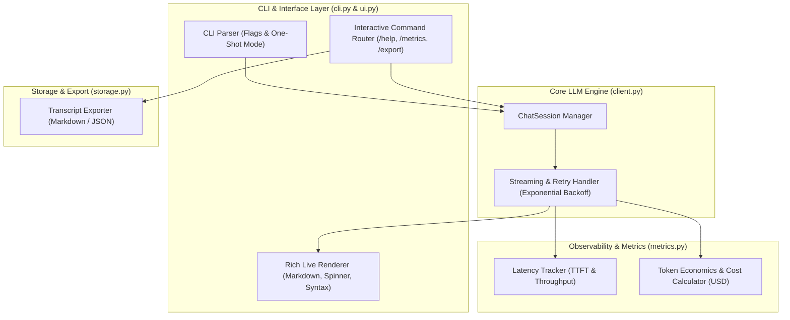

# llm-chat-cli

[](https://github.com/satriowahyup/llm-chat-cli/actions)
[](https://www.python.org/)
[](https://github.com/astral-sh/uv)
[](https://github.com/astral-sh/ruff)
[](https://ai.google.dev/)

> **Production-Grade AI Terminal Chatbot** powered by the Google Gemini API.  
> Designed with modern software engineering and **Forward Deployed Engineer (FDE)** practices: decoupled layered architecture, comprehensive observability, live Markdown streaming, token economics, and robust resilience.

---

## Key Features

- **Rich Terminal UX:** Real-time live Markdown streaming, automatic syntax highlighting for code blocks across languages, and an animated spinner indicator (*thinking status*).
- **Observability & Token Economics:** Tracks millisecond-level **Time To First Token (TTFT)**, generation throughput (**tokens/sec**), prompt vs. candidate token breakdowns, and real-time **estimated cost (USD)** based on official Gemini pricing tiers.
- **CLI Parameterization & One-Shot Mode:** Flexible CLI flags (`--model`, `--temperature`, `--system`) plus non-interactive one-shot execution (`-p, --prompt`) for Unix pipeline and scripting integrations.
- **Session Transcript Exporter:** Seamlessly export full conversation history with complete session metadata to clean **Markdown** or structured **JSON** into a dedicated `transcripts/` directory via `/export`.
- **Resilience & Exponential Backoff:** Built-in automatic retry mechanism with exponential backoff (1s, 2s, 4s) to handle transient API errors (HTTP 429, 500, 503) before streaming commences.
- **Engineering Rigor:** 100% mock-based unit test suite (zero API credit waste), strict linting and formatting via `ruff`, and automated **GitHub Actions CI**.

---

## Architecture Overview

The system strictly follows the principle of **Separation of Concerns**:



---

## Getting Started

### Prerequisites
- Python 3.11+
- [uv](https://github.com/astral-sh/uv) (recommended fast Python package manager)
- Google Gemini API Key (obtain from [Google AI Studio](https://aistudio.google.com/))

### Installation
1. **Clone the repository:**
   ```bash
   git clone https://github.com/satriowahyup/llm-chat-cli.git
   cd llm-chat-cli
   ```

2. **Sync dependencies with `uv`:**
   ```bash
   uv sync
   ```

3. **Configure Environment:**
   Copy the example `.env` file and set your Gemini API key:
   ```bash
   cp .env.example .env
   ```
   Edit `.env`:
   ```env
   GEMINI_API_KEY=your_gemini_api_key_here
   GEMINI_MODEL=gemini-2.5-flash
   ```

---

## Usage

### 1. Interactive Chat Session
Launch the terminal chatbot:
```bash
uv run python -m llm_chat_cli
```

You can customize parameters on the fly using CLI flags:
```bash
uv run python -m llm_chat_cli --model gemini-2.5-flash --temperature 0.2 --system "You are a senior Python code reviewer."
```

### 2. Non-Interactive / One-Shot Mode (`-p, --prompt`)
Execute a single prompt and exit directly (ideal for shell scripts and automated pipelines):
```bash
uv run python -m llm_chat_cli -p "Explain the difference between concurrency and parallelism in two sentences."
```

---

## Interactive Commands

Inside an interactive chat session, use the following commands prefixed with `/`:

| Command | Description |
|---|---|
| `/help` | Display the interactive command guide |
| `/metrics` | View detailed telemetry table (**TTFT**, **throughput**, **USD cost**) |
| `/export [file]` | Export conversation transcript to Markdown (`.md`) or JSON (`.json`) into `transcripts/` |
| `/tokens` | Display summary of token consumption and total session cost |
| `/reset` | Clear conversation history and reset session metrics |
| `/system <prompt>` | Update system persona/instruction on the fly (resets conversation) |
| `/exit`, `/quit` | Safely exit the application |

---

## Development & Quality Assurance

All unit tests use mock Gemini clients, ensuring fast and deterministic execution without incurring API costs.

1. **Run Unit Test Suite:**
   ```bash
   uv run python -m pytest
   ```

2. **Run Linter & Formatting Checks (`ruff`):**
   ```bash
   uv run python -m ruff check .
   uv run python -m ruff format --check .
   ```

---

## Project Structure

```text
llm-chat-cli/
├── .github/
│   └── workflows/
│       └── ci.yml             # GitHub Actions CI workflow (lint & test matrix)
├── src/
│   └── llm_chat_cli/
│       ├── __init__.py
│       ├── __main__.py        # Entry point for python -m llm_chat_cli
│       ├── cli.py             # CLI parser, routing, one-shot mode
│       ├── client.py          # ChatSession, streaming engine, exponential retry
│       ├── config.py          # Settings dataclass & env validator
│       ├── metrics.py         # Telemetry, TTFT, throughput, token economics
│       ├── storage.py         # Transcript exporter (Markdown & JSON)
│       └── ui.py              # Rich rendering, live markdown, spinner, tables
├── tests/
│   ├── test_cli.py            # CLI argument parsing and one-shot tests
│   ├── test_client.py         # Streaming, 429 retry backoff, token tracking tests
│   ├── test_metrics.py        # Telemetry & cost calculation tests
│   ├── test_storage.py        # Markdown and JSON export tests
│   └── test_ui.py             # Rich console & stream rendering tests
├── transcripts/
│   └── .gitkeep               # Directory for exported chat transcripts
├── .env.example               # Safe template for environment variables
├── .gitignore                 # Preconfigured ignores (secrets, transcripts, caches)
├── pyproject.toml             # Project dependencies and tool configurations
└── uv.lock                    # Deterministic lockfile
```

---

## License

Distributed under the [MIT License](LICENSE).
